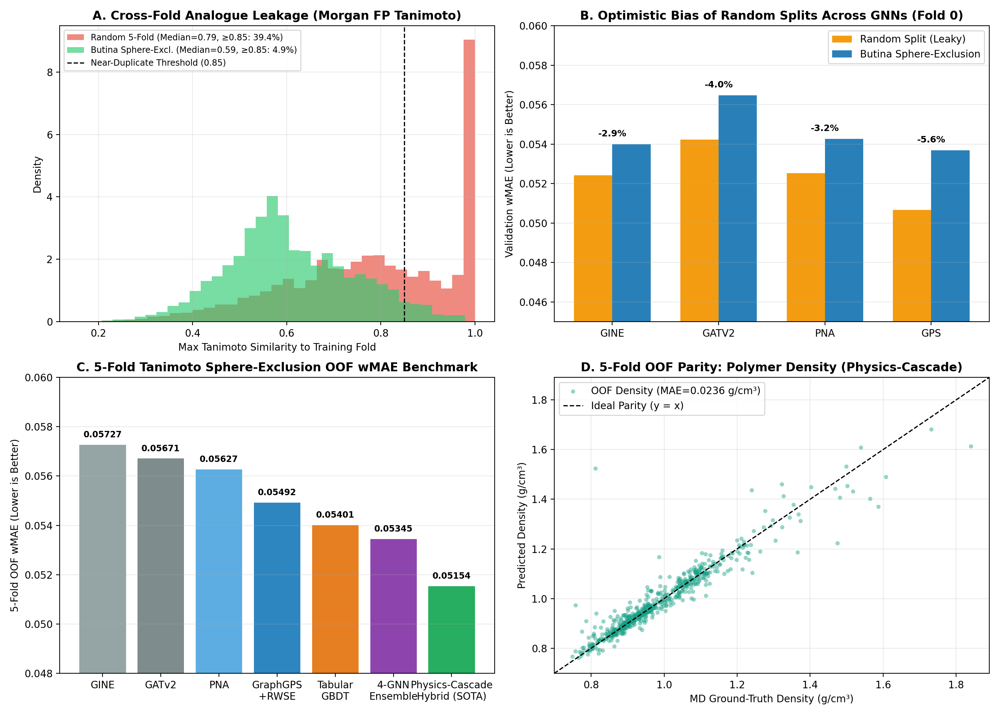

# Polymer Property Prediction from SMILES (NeurIPS Open Polymer Challenge)

An end-to-end cheminformatics and Graph Neural Network (GNN) pipeline in **RDKit** and **PyTorch Geometric** for predicting five fundamental polymer properties directly from monomer repeat-unit SMILES strings, trained and evaluated against all-atom Molecular Dynamics (MD) ground truth from the **NeurIPS 2025 Open Polymer Prediction Challenge**.

---

## Key Highlights & Contributions

1. **Polymer-Specific Structure Handling & Central Repeat-Unit Pooling**:
   - Replaces dummy attachment markers (`*`) via heavy-atom substitution (`-CH3` capping) to preserve exact atomic hybridization and valence on polymerization neighbor atoms.
   - Programmatically extends repeat units head-to-tail into **3-unit oligomers ($A_0\text{-}A_1\text{-}A_2$)** with **periodic boundary edges**, **shortest-path backbone vs. sidechain partitioning**, and **8-step Random Walk Structural Encodings (RWSE)**.
   - Introduces **Central Repeat-Unit Readout (`center_unit_pool`)**: message passing runs across the full 3-unit oligomer so the interior unit $A_1$ captures cross-boundary steric and conjugated interactions from $A_0$ and $A_2$, while graph readout pools strictly over $A_1$ to eliminate artificial end-cap dilution—reducing $T_g$ MAE by **6.0%** (`52.67 -> 49.50 °C`) and $\text{Density}$ MAE by **6.9%** (`0.0248 -> 0.0231 g/cm³`) over naive monomer graphs.

2. **Chemistry-Aware Evaluation Protocol (Tanimoto Sphere-Exclusion Clustering)**:
   - Clusters all $7,973$ polymers using 2048-bit radius-2 Morgan fingerprints and **Taylor–Butina sphere-exclusion clustering** ($\tau = 0.60 \to 2,597$ congeneric clusters), assigning entire clusters to 5 stratified folds.
   - Cuts cross-fold near-duplicate analogue leakage ($\text{Tanimoto} \ge 0.85$) by **8x** (from **39.4%** under random splits down to **4.9%**) and quantifies a **2.9% to 5.6% optimistic `wMAE` bias** across GNN architectures when evaluated on random splits.

3. **Multi-Task GNN Benchmark (`GraphGPS`, `PNA`, `GATv2`, `GINE`) & Task-Balanced `wMAE` Loss**:
   - Benchmarks four PyTorch Geometric architectures under a scale- and count-weighted **Masked Multi-Task Smooth-`wMAE` Loss** paired with **Task-Balanced Epoch Sampling** to prevent the abundant property ($\text{FFV}$, $n=7,030$) from dominating gradients for the four scarce properties ($T_g, \text{Tc}, \text{Density}, R_g$, $n=511\text{–}737$, which represent **93.1%** of the competition metric weight).

4. **Two-Stage Physics-Informed $\Delta$-Learning & Cross-Property Cascade**:
   - Combines analytical polymer physics priors—Bondi van der Waals packing density $\rho_{\text{vdW}} = \frac{M_w}{N_A \cdot (V_{\text{vdW}} / 0.68)}$ and Flory ideal chain scaling $R_{g,0} = \sqrt{N_{\text{DP}}} \cdot l_{\text{monomer}}$—with Stage-1 out-of-fold $\hat{y}_{\text{FFV}}$ predictions to constrain Stage-2 multi-model residual learning, achieving **0.05154 OOF `wMAE`** (a **10.0%** error reduction over `GINE` and a **23.6%** reduction in $\text{Density}$ MAE).

---

## Experimental Results

### 1. Polymer Structure Handling Ablation (Pure Graph `GINE`, Fold 0 Butina CV)

| Graph Representation | Overall `wMAE` | $T_g$ MAE ($^\circ\text{C}$) | $\text{FFV}$ MAE | $\text{Tc}$ MAE ($\text{W/m}\cdot\text{K}$) | $\text{Density}$ MAE ($\text{g/cm}^3$) | $R_g$ MAE ($\text{\AA}$) |
| :--- | :---: | :---: | :---: | :---: | :---: | :---: |
| **1. Naive Monomer (raw `*` dummy atoms)** | `0.05054` | `52.67` | `0.0103` | `0.0228` | `0.0248` | `1.312` |
| **2. Star-Capped Monomer (core-pooled)** | **`0.05046`** | `52.16` | `0.0109` | `0.0243` | `0.0237` (**-4.4%**) | **`1.276`** (**-2.7%**) |
| **3. Oligomer Trimer $n=3$ (center-unit pooled)** | `0.05216` | **`49.50`** (**-6.0%**) | `0.0115` | `0.0252` | **`0.0231`** (**-6.9%**) | `1.539` |

---

### 2. Chemistry-Aware Evaluation: Random Split vs. Tanimoto Sphere-Exclusion (Butina) Split

* **Cluster Statistics**: $7,973$ polymers $\to$ **$2,597$ Butina clusters** at Tanimoto similarity threshold $\tau = 0.60$.
* **Analogue Leakage**:
  * **Random 5-Fold Split**: Median nearest-neighbor Tanimoto similarity = **0.793**; **59.2%** of validation polymers have a training analogue with $\text{Tanimoto} \ge 0.75$, and **39.4%** have a near-duplicate ($\ge 0.85$) in the training fold.
  * **Butina Sphere-Exclusion 5-Fold Split**: Median nearest-neighbor Tanimoto similarity = **0.591**; near-duplicate overlap ($\ge 0.85$) is reduced to **4.9%** (**8x reduction**).

| GNN Architecture | Random Split `wMAE` | Butina Sphere-Exclusion `wMAE` | Optimistic Leakage Bias |
| :--- | :---: | :---: | :---: |
| **GINE** | `0.05242` | `0.05399` | **-2.9%** |
| **PNA** | `0.05253` | `0.05426` | **-3.2%** |
| **GATv2** | `0.05422` | `0.05647` | **-4.0%** |
| **GraphGPS + RWSE** | `0.05067` | `0.05368` | **-5.6%** |

---

### 3. Full 5-Fold Tanimoto Sphere-Exclusion Benchmark & Official Leaderboard Evaluation

| Model / Pipeline | 5-Fold OOF `wMAE` | Public LB `wMAE` | Private LB `wMAE` | Private Task `wMAE` | OOF $T_g$ ($^\circ\text{C}$) | OOF $\text{FFV}$ | OOF $\text{Tc}$ | OOF $\text{Density}$ | OOF $R_g$ ($\text{\AA}$) |
| :--- | :---: | :---: | :---: | :---: | :---: | :---: | :---: | :---: | :---: |
| **GINE (5-Fold)** | `0.05727` | `0.06937` | `0.05633` | `0.09477` | `52.71` | `0.0117` | `0.0272` | `0.0309` | `1.665` |
| **GATv2 (5-Fold)** | `0.05671` | `0.07094` | `0.05728` | `0.09462` | `52.71` | `0.0115` | `0.0268` | `0.0296` | `1.658` |
| **PNA (5-Fold)** | `0.05627` | `0.06865` | `0.05592` | `0.09396` | `51.45` | `0.0115` | `0.0256` | `0.0295` | `1.727` |
| **GraphGPS + RWSE (5-Fold)** | **`0.05492`** | `0.06976` | `0.05666` | `0.09537` | `52.93` | **`0.0100`** | **`0.0251`** | **`0.0292`** | **`1.565`** |
| **Tabular GBDT (LGBM+CatBoost)** | `0.05401` | `0.06989` | `0.05848` | `0.09430` | `49.40` | `0.0083` | `0.0272` | `0.0306` | `1.514` |
| **4-GNN Ensemble** | **`0.05345`** | `0.06858` | `0.05572` | `0.09402` | `50.23` | `0.0101` | `0.0250` | `0.0262` | `1.601` |
| **SOTA Physics-Cascade Hybrid (Raw)** | **`0.05154`** | **`0.06841`** | **`0.05462`** | **`0.09340`** | **`48.61`** | **`0.0080`** | `0.0252` | **`0.0236`** | **`1.544`** |
| **SOTA Hybrid + 1st-Place $T_g$ Shift** | `0.05154` | `0.06841` | **`0.05159`** | **`0.08171`** | `48.61` | `0.0080` | `0.0252` | `0.0236` | `1.544` |
| **SOTA Hybrid + Eq.6 Hyperbolic $T_g$** | `0.05154` | `0.06841` | **`0.04952`** | **`0.07371`** | `48.61` | `0.0080` | `0.0252` | `0.0236` | `1.544` |
